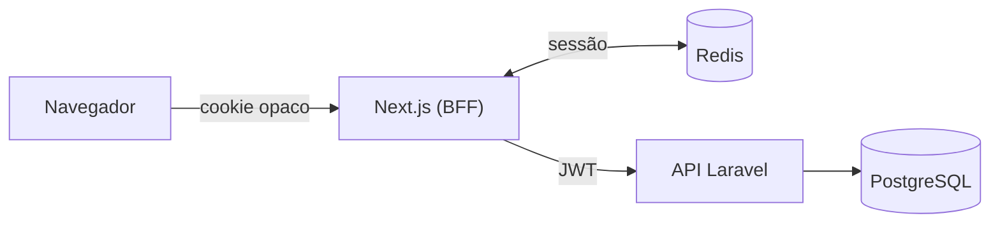

# Laravel Next Starter

Base pronta para sistemas web com **API Laravel** e **front-end Next.js**, com login seguro, permissões, multi-empresa e os módulos de uso mais comum já implementados.

---

## O que já vem pronto

- 👤 Usuários, grupos e permissões
- 🏢 Empresas e grupos de empresas (multi-tenant)
- 🔐 Login com 2FA, sessões revogáveis e Acesso de Suporte
- 💬 Mensagens, banners e novidades da plataforma
- 🎫 Chamados de suporte com anexos
- 📊 Dashboard e trilha de auditoria

Duas áreas espelhadas: **Admin** (equipe interna) e **Private** (cliente, isolado por empresa).

## Como funciona



> O navegador **nunca** fala direto com a API e **nunca** recebe o JWT: ele fica no servidor, no Redis.

## Stack

| Camada | Tecnologias |
|---|---|
| Backend | PHP 8.5 · Laravel 13 · PostgreSQL 17 · JWT · Pest |
| Frontend | Next.js 16 · React 19 · TypeScript · Tailwind 4 · shadcn/ui |
| Sessões | Redis 7 (**obrigatório**: sem ele o login não funciona) |

## Rodar na sua máquina

Pré-requisitos: Git, Docker, Node.js 22.22.2+, PHP 8.5 e Composer. Passo a passo completo em [`docs/instalacao-local.md`](./docs/instalacao-local.md).

```bash
git clone https://github.com/caiotzu/laravel-next-starter.git && cd laravel-next-starter

# Backend  →  http://localhost
cd backend
composer install && cp .env.example .env
./vendor/bin/sail up -d
./vendor/bin/sail artisan key:generate && ./vendor/bin/sail artisan jwt:secret
./vendor/bin/sail artisan migrate --seed

# Frontend (outro terminal)  →  http://localhost:3000
cd frontend
npm ci && cp .env.example .env && npm run dev
```

| Área | Endereço | Usuário de teste |
|---|---|---|
| Admin | <http://localhost:3000/admin> | `admin@admin.com.br` / `Admin123@` |
| Cliente | <http://localhost:3000/> | `private@private.com.br` / `Private123@` |

> ⚠️ São contas de **desenvolvimento**. Nunca use em produção.

## Documentação

| Quero… | Leia |
|---|---|
| Rodar na minha máquina | [`instalacao-local.md`](./docs/instalacao-local.md) |
| Publicar em um servidor | [`implantacao-servidor.md`](./docs/implantacao-servidor.md) |
| Conferir antes de publicar | [`checklist-producao.md`](./docs/checklist-producao.md) |
| Testar se tudo funciona | [`roteiro-de-validacao.md`](./docs/roteiro-de-validacao.md) |
| Entender / evoluir o backend | [`backend.md`](./docs/backend.md) |
| Entender / evoluir o frontend | [`frontend.md`](./docs/frontend.md) |
| Ver os dispositivos de segurança | [`seguranca.md`](./docs/seguranca.md) |
| Escrever e rodar testes | [`testes.md`](./docs/testes.md) |
| Saber por que essa arquitetura | [`vantagens.md`](./docs/vantagens.md) |
| Configurar upload de arquivos (disco/S3) | [`armazenamento-de-arquivos.md`](./docs/armazenamento-de-arquivos.md) |
| Orientar a IA no projeto | [`CLAUDE.md`](./CLAUDE.md) |

Cada pasta tem seu README: [`backend/`](./backend/README.md) · [`frontend/`](./frontend/README.md).
