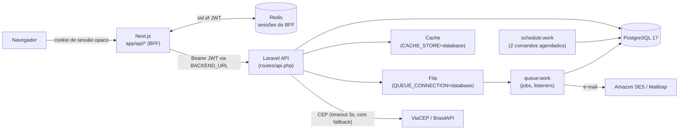

# Arquitetura

## Visão geral



O navegador nunca fala diretamente com o Laravel. Toda chamada passa pelo Next.js, que decide o que repassar. **O JWT nunca chega ao navegador:** ele fica no servidor, no Redis, associado a um identificador de sessão aleatório e opaco (`sid`, 256 bits); o navegador guarda apenas o cookie com esse `sid` (`HttpOnly`, `SameSite=Lax`, `Secure` e prefixo `__Host-` em produção). A cada chamada o BFF troca o `sid` pelo JWT e injeta `Authorization: Bearer` na requisição ao backend. Os handlers de login e 2FA devolvem ao navegador o `data` do backend **sem o campo `token`**.

O projeto modela dois contextos de acesso, replicados em ambas as camadas:

- **Admin** — área interna/administrativa (gestão de empresas, usuários, grupos, permissões);
- **Private** — mesmas funcionalidades, escopadas por empresa/usuário final.

## Backend

Cada requisição autenticada segue o mesmo fluxo em camadas:

```text
Route (routes/api.php)
   → Controller (app/Http/Controllers/{Admin,Private,Global,Lookup})
   → Form Request (validação em app/Http/Requests)
   → DTO (app/DTO) — normaliza os dados validados
   → Service (app/Services) — regra de negócio, transações, eventos
   → Repository (app/Repositories) — só para dados com dono (Usuario, Grupo); ver repositories.md
   → Model (app/Models) — persistência (Eloquent)
   → Resource (app/Http/Resources) — formata a resposta JSON
```

Os controllers também carregam atributos OpenAPI (`#[OA\Post(...)]` etc.) — a especificação Swagger vive junto do código, não em YAML separado.

### Estrutura de diretórios (`backend/app`)

```text
app/
├── Console/Commands/   # Comandos artisan customizados
├── Contracts/          # Interfaces de serviços externos (Cep, Email)
├── DTO/                # Um DTO por caso de uso
├── Enums/              # Status, tipos, códigos de erro
├── Events/ Listeners/  # Eventos de domínio e reações
├── Exceptions/         # Ex.: BusinessException
├── Http/
│   ├── Controllers/{Admin,Private,Global,Lookup}/
│   ├── Middleware/     # JwtMiddleware, AudienciaMiddleware, AcessoSuporteMiddleware,
│   │                   # SecurityHeadersMiddleware, SwaggerAdminAuth
│   ├── Requests/
│   └── Resources/
├── Jobs/
├── Models/
├── Repositories/       # Acesso a dados com dono (Grupo, Usuario) — ver repositories.md
├── OpenApi/            # Schemas/respostas OpenAPI reutilizados
├── Providers/          # AuthServiceProvider (Gate::before)
├── Services/
│   └── External/       # Cep: BrasilAPI/ViaCEP · Email: SES/Mailtrap
└── Support/
```

Integrações externas (CEP, e-mail) ficam isoladas atrás de interfaces em `app/Contracts`, com implementação trocável via configuração (`EMAIL_PROVIDER`).

## Frontend (BFF)

O fluxo de autenticação/proxy:

1. A página chama uma rota interna em `app/api/auth/**` (ex.: `/api/auth/admin/login`);
2. Essa rota valida a origem da requisição (`validarOrigem`), chama o Laravel via `BACKEND_URL` (variável só de servidor), cria uma **sessão no Redis** (`lib/session/`, chave `bff:sess:<sid>`, TTL = tempo restante do JWT) com o JWT dentro e grava no navegador só o cookie opaco (`admin_sid` / `private_sid`; em produção `__Host-admin_sid` / `__Host-private_sid`). Se o navegador já tinha uma sessão do mesmo contexto, ela é destruída antes (anti fixação de sessão);
3. Chamadas seguintes passam por `app/api/proxy/{admin,private}`, que valida a origem, **resolve o JWT pela sessão no Redis** (sem sessão válida responde 401 **sem chamar o backend**; Redis fora do ar responde 503), resolve o destino com `lib/proxy-guard.ts` (só caminhos dentro de `BACKEND_URL`, métodos GET/POST/PUT/PATCH/DELETE e apenas o header `X-Acesso-Suporte-Id`), injeta `Authorization: Bearer` e o IP do cliente validado (`lib/client-ip.ts`) e repassa a chamada. Um 401 do backend destrói a sessão. O proxy nunca encaminha `login`, `2fa/verificar`, `refresh` nem `logout` (um `/refresh` devolveria um JWT ao navegador). `GET /api/health` informa se o Redis responde (200/503);
4. `proxy.ts` (antigo `middleware.ts`, roda em Node) intercepta a navegação e usa `routes/routes.ts` (campo `contexto`) para redirecionar quando **não há sessão válida no Redis** (ou para o dashboard certo, se já autenticado). Falha fechada: com o Redis fora do ar a rota protegida redireciona para o login;
 5. O logout (`app/api/auth/{admin,private}/logout`) revoga o token no backend (melhor esforço), destrói a sessão no Redis e apaga o cookie, mesmo que o backend ou o Redis falhem.

**Vários usuários ao mesmo tempo.** Cada login cria um `sid` novo e independente: pessoas diferentes (ou a mesma pessoa em casa e no trabalho) têm sessões, tokens e logouts separados. Admin e Private no mesmo navegador também têm sessões separadas (dois cookies).

### Estrutura de diretórios (`frontend/`)

```text
frontend/
├── app/
│   ├── admin/              # Páginas da área Admin
│   ├── (private)/          # Páginas da área Private (route group)
│   └── api/
│       ├── auth/           # Login/logout/2FA/primeiro acesso/senha — cria/encerra a sessão no Redis e o cookie opaco (não há handler de refresh)
│       └── proxy/          # Proxy autenticado para a API Laravel
├── domains/                # Dados por contexto/recurso: types, services, hooks, mappers
├── features/               # UI por contexto/recurso: components, schemas
├── components/             # ui (shadcn), layouts, data-tables, forms, feedback, providers
├── hooks/                  # Hooks compartilhados
├── lib/                    # Helpers de proxy (proxy-guard, client-ip, proxy-admin/private), validações Zod
├── routes/routes.ts        # Mapa de rotas protegidas (consumido pelo middleware)
└── proxy.ts                # Proteção de rotas pela sessão no Redis (antigo middleware.ts)
```

Mais detalhes de cada pasta em [`frontend-arquitetura.md`](./frontend-arquitetura.md).

## Cache e armazenamento

- **Cache:** `CACHE_STORE=database` no `.env.example` (tabela `cache`). É usado para o cache de permissões por grupo/versão (`Usuario::permissoesCache()`), para os `temp_token` do 2FA, para o controle anti-replay de TOTP e para os contadores do rate limit. Há variáveis de Redis/Memcached no `.env.example`, mas o backend não usa Redis (o Redis das sessões é do frontend, ver [`redis-producao.md`](./redis-producao.md));
- **Dados com dono (Usuario, Grupo):** consultas ficam em `GrupoRepository`/`UsuarioRepository` e recebem sempre um `EscopoEntidade` (resolvido por `EscopoEntidadeService::atual()`), o que impede esquecer o filtro de empresa. Detalhes em [`repositories.md`](./repositories.md).
- **Arquivos:** todo upload passa por `FileStorageInterface` (provider escolhido por `FILE_STORAGE_DRIVER`: `local` por padrão, `s3` preparado). Anexos de chamado ficam no armazenamento privado e só são entregues por link assinado; o comando `chamados:mover-anexos-privados` migra anexos legados do público. Detalhes em [`armazenamento-de-arquivos.md`](./armazenamento-de-arquivos.md).
